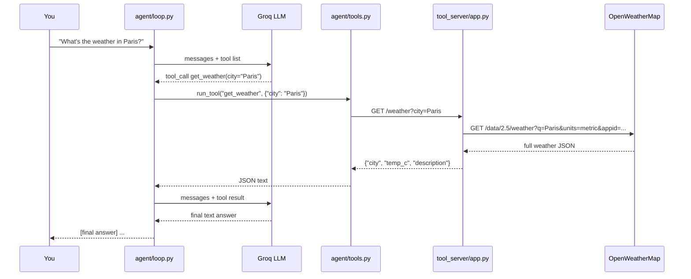

# Agent loop lesson

A minimal, framework-free agent: an LLM on Groq that can call one tool
(`get_weather`), served by a tiny Flask app that in turn calls OpenWeatherMap.
The loop in `agent/loop.py` is the whole lesson; everything else is plumbing.

New to this? Start with [TUTORIAL.md](TUTORIAL.md): it hands over the files one
at a time, with something to run and something to break at each step.

```
agent-lesson/
├── config.py            # reads and validates keys directly from secrets.json
├── tool_server/
│   ├── app.py           # Flask: GET /weather?city=...
│   └── weather.py       # calls OpenWeatherMap
├── agent/
│   ├── loop.py          # the agent loop: LLM -> tool -> LLM until a final answer
│   ├── tools.py         # tool schema + dispatch to the Flask endpoint
│   └── llm.py           # the only file that talks to Groq
└── ui_server/           # optional: a web page in front of the loop
    ├── app.py           # Flask: GET / (the page) and POST /ask -> run_agent
    ├── templates/index.html
    └── static/          # style.css, app.js
```

## Setup

Python 3.10 or newer. A virtual environment is optional; if you use one, create and activate it first.

1. Install requirements
   ```
   python -m pip install -r requirements.txt
   ```
   Use the same `python` command to install and to run the scripts (on some systems it is `python3` or `py`).
   Mixing them puts the libraries in a different Python and you get `No module named ...`.

    The Groq client uses the operating system's certificate trust store via
    `truststore`, including company-managed certificates installed in Windows.
    If you see `CERTIFICATE_VERIFY_FAILED`, ask IT to install the approved company
    root certificate in the OS trust store. Do not disable certificate verification.
    Restart the UI server after installing requirements or updating certificates.

2. Add your API keys: copy `secrets.example.json` to `secrets.json` and fill in both values.
   `secrets.json` is gitignored; never put real keys in the example file.

   Keys: https://openweathermap.org/api and https://console.groq.com/keys.
    Both clients read their keys directly from this JSON file. Environment variables
    are not used for API keys. Both keys must be non-empty strings.

## Run

Start both servers from one terminal:
```
python run_servers.py
```
Open http://127.0.0.1:8000. Press **Ctrl+C** in that terminal to stop both servers.
The launcher uses the same Python environment for both processes and stops the
other server if either exits. Logs from both appear in the same terminal.

Stop any previously started servers first. The launcher reports occupied ports
without stopping processes it does not own. To use a different UI port:
```
python run_servers.py --ui-port 8001
```
The weather tool always uses port 5000; the agent loop runs inside the UI server,
so there is no third server to start. Groq and OpenWeatherMap are external APIs.

### Running separately

Terminal 1 - start the tool server:
```
python tool_server/app.py
```

Terminal 2 - check the endpoint:
```
curl "http://localhost:5000/weather?city=London"
```
(In PowerShell `curl` is an alias for `Invoke-WebRequest`; use `curl.exe` to see the raw JSON.)

Terminal 2 - run the agent:
```
python agent/loop.py "What's the weather in Paris?"
```

Expected output:
```
[step 1] LLM requested get_weather(city=Paris)
[tool result] {"city":"Paris","description":"clear sky","temp_c":18.3}
[final answer] It's currently about 18 °C in Paris with clear skies.
```

Optional - a web page instead of the terminal (Terminal 1 still running):
```
python ui_server/app.py
```
then open http://127.0.0.1:8000. The same `[step ...]` lines appear on the page and in that terminal.
The page only calls `POST /ask`, which runs the same `run_agent()`; nothing in `agent/` changes.

## The request path

`you -> agent/loop.py -> Groq -> agent/tools.py -> Flask (tool_server/app.py) -> OpenWeatherMap -> back up the same chain -> Groq -> final answer`



1. `loop.py` sends the question and the tool list to the model.
2. The model replies with a *request* to call `get_weather`, not with an answer.
3. `tools.py` turns that request into an HTTP GET to the Flask server.
4. `app.py` calls OpenWeatherMap, trims the reply to `{city, temp_c, description}`, returns JSON.
5. `loop.py` appends that JSON as a `tool` message and calls the model again.
6. The model now has real data and replies with text, which ends the loop.

The LLM never touches the network itself. It only produces a request; your code
decides whether and how to run it. That separation is the entire idea of an agent loop.

## Swapping pieces

- Another OpenAI-compatible provider: change the client and `MODEL` in `agent/llm.py`.
- Another tool: add a schema to `TOOLS` and a handler to `TOOL_HANDLERS` in `agent/tools.py`.
- Another front end: anything that can `POST /ask` with `{"question": "..."}` to `ui_server/app.py`; the loop never changes.
